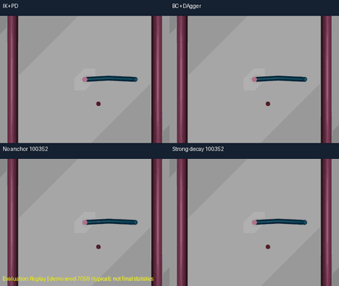
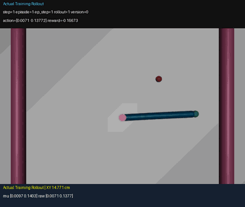

# 基于模仿学习与策略约束的机器人在线强化学习控制

在MuJoCo Reacher中结合专家示教、BC、DAgger和固定BC动作均值约束，诊断PPO在线微调退化，并记录真实随机采样与网络更新。

[English](README.md) · [实验协议](docs/02_实验协议与结果核对.md) · [源码来源](reports/source_provenance.csv)

## 控制效果演示



**Evaluation Replay：**同一初态和目标下对比IK+PD、BC+DAgger、无锚定PPO和Strong衰减PPO。7059/7012仅为演示种子，不是最终统计。[原始完整对比](assets/videos/01_same_start_comparison.gif) · [70秒综合演示](assets/videos/00_project_overview.gif)。

## 总体流程


## 最终冻结结果

| Method | Additional PPO steps / seed | Stable success | Mean final XY error |
|---|---:|---:|---:|
| BC + DAgger | 0 | 58.67% | 2.3029 cm |
| PPO without anchoring | 100352 | 32.33% | 2.7527 cm |
| PPO with decaying strong anchoring | 100352 | 64.67% | 1.9986 cm |

统一3训练种子42/123/2026，每模型100个测试初态16000～16099。PPO长微调每种子新增100352在线环境步；BC的0步仅表示无在线PPO，不表示没有示教成本。250步回合、dt.02、距离/控制奖励权重1/1，稳定成功要求最后连续5步XY距离均严格<1cm，不直接与其他环境默认协议比较。

逐回合CSV重算并与NPZ核对：[完整五组统计](reports/final_results.csv)、[种子差异](reports/per_seed_results.csv)、[模型SHA](reports/model_manifest.csv)。64.67%对58.67%的差异为描述性的+6.00个百分点，不宣称统计显著，也未超越IK+PD专家。


## 核心实现

- 控制与模仿：10维输入、2维动作，IK+PD专家、仅Actor监督BC及一次DAgger状态聚合。
- 策略退化诊断：独立BC重启、分组Actor/Critic学习率、均值偏差/KL、梯度与实际Adam步审计，保留失败和种子差异。
- BC Anchoring：真实rollout状态上的原始高斯动作均值MSE，教师冻结且不进优化器；Actor/Critic学习率1e-5/3e-4、全局裁剪.5，固定与衰减日程保留验证过的原实现。
- 工程复现：验证/最终测试分离、1024实际采样步边界、完整checkpoint哈希、CSV/NPZ校验和仅上传文件隔离测试，不把既有算法组合称为原创算法。

## 安装与快速开始

已在现有Windows Python3.11.17环境验证，未声称全新电脑独立安装或其他系统验证成功。标准安装模板：

```powershell
python -m venv .venv
.\.venv\Scripts\Activate.ps1
python -m pip install -r requirements.txt
```

以下不依赖历史模型、数据：

```powershell
python scripts/portfolio.py --help
python scripts/portfolio.py results
python scripts/portfolio.py evaluate --method ikpd --first-seed 17080 --episodes 2 --output results/expert_diagnostic
python scripts/portfolio.py pipeline --profile smoke --output results/my_smoke --ppo-method anchor
```

烟雾流程500训练专家标签、250验证标签、250DAgger标签/在线步，监督阶段各2epoch，最后1024PPO步；使用本次新训练教师，不是新正式研究结果。每次用新输出目录。[完整复现入口与成本](docs/03_完整训练复现与工程结构.md)。

预训练权重、诊断NPZ和原始轨迹仍不分发。需要预训练演示/真实在线录制时，单独取得授权的15个ZIP及诊断NPZ，路径见configs/models.json，SHA见reports/asset_provenance.csv。以下导入假设已持有原归档，不会下载权重；缺失时提示路径和哈希：

```powershell
python scripts/portfolio.py import-assets --archive-root ..
python scripts/portfolio.py init
python scripts/portfolio.py watch --policy compare --seed 7059
python scripts/portfolio.py train --output results/my_demo --steps 4096 --record-training-rollouts
python scripts/portfolio.py replay --run results/my_demo --mode actual --episode 13
python scripts/portfolio.py replay --run results/my_demo --mode compare --update 1
```

## 真正的PPO在线试错



**Actual Training Rollout：**RGB来自PPO实际调用的训练环境，显示随机动作、原始奖励、定位误差与策略版本；没有重新predict生成替代动作，也没有多step。预选episode1/5/9/13包含失败且明确显示录制间隔；1024步更新可能发生在回合中间。10fps预览只减少显示采样，不改变原轨迹。[完整实际录像](assets/videos/02_actual_online_learning.gif)、[BC到最终策略](assets/videos/03_bc_vs_final_policy.gif)、[失败案例](assets/videos/04_failure_cases.gif)、[动画校验](reports/public_media_validation.json)。

--render-training直接打开真实训练env；与RGB录制分开运行。compare是训练后独立确定性Evaluation Replay，不能冒充真实采样。[详细中文教程](docs/真实PPO试错过程_运行与可视化教程.md)。TensorBoard：`python -m tensorboard.main --logdir results/my_demo/tensorboard --port 6008`。

## 局限与来源

单任务仿真、仅3训练种子，没有实机部署、跨机器人或Sim-to-Real实验，没有统计显著性声明。低漂移不保证高定位精度；本次发布没有100k重训或调beta。GIF均为已核验的真实仿真录像，预览来自原GIF压缩，5份原件不变。权重、训练数据、大型原始状态/RGB继续排除。

用户已明确授权独立开发源码、文档、结果、图片和本次核验GIF公开。third_party保留适用许可证及NOTICE，[依赖声明](reports/dependency_licenses.csv)与[来源审计](docs/04_来源与发布许可核对.md)保留。未擅自为项目选择MIT/Apache等开源许可证，Public可见性不等同于另行授予未确定的开源许可。

参考：[PPO](https://arxiv.org/abs/1707.06347)、[DAgger](https://proceedings.mlr.press/v15/ross11a.html)、[SB3](https://jmlr.org/papers/v22/20-1364.html)、[MuJoCo](https://mujoco.org/)、[Gymnasium Reacher](https://gymnasium.farama.org/environments/mujoco/reacher/)。
