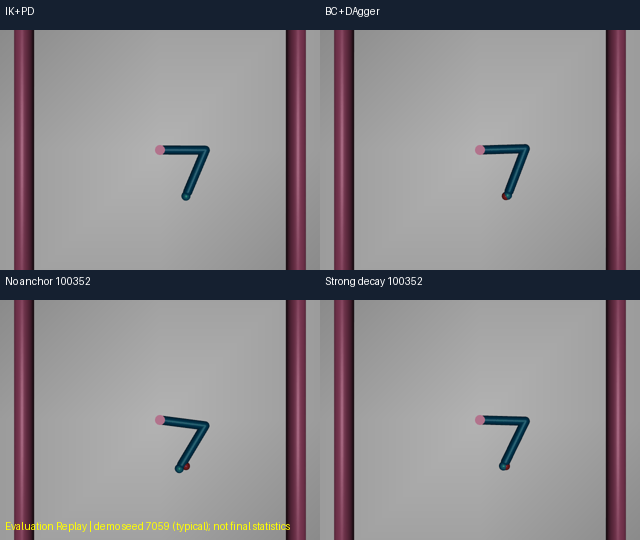
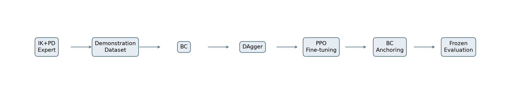
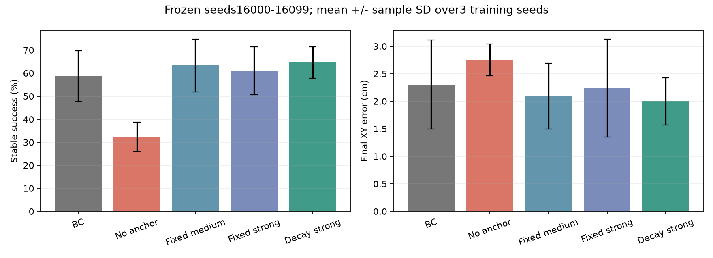

# 基于模仿学习与策略约束的机器人在线强化学习控制

[English](README.md) · [完整收尾报告](项目收尾完成报告.md) · [运行教程](docs/真实PPO试错过程_运行与可视化教程.md)

在MuJoCo Reacher中实现IK+PD示教、BC、DAgger与固定BC参考策略约束的PPO，研究在线微调退化及梯度约束尺度，并记录真实随机探索和网络更新。



最终冻结测试复核：Strong衰减方案稳定成功率**64.67%**、平均末端XY误差**1.9986 cm**；BC对应**58.67% / 2.3029 cm**。差异为**+6.00个百分点**、平均误差下降**13.21%**，属于三训练种子的描述性结果。

| Method | Steps / seed | Stable success | Final XY error | Action cost |
|---|---:|---:|---:|---:|
| BC + DAgger | 0 | 58.67% | 2.3029 cm | 0.157358 |
| PPO, no anchor | 100352 | 32.33% | 2.7527 cm | 0.157019 |
| Fixed medium | 100352 | 63.33% | 2.0939 cm | 0.161475 |
| Fixed strong | 100352 | 61.00% | 2.2421 cm | 0.154540 |
| Decaying strong | 100352 | 64.67% | 1.9986 cm | 0.162236 |

表格从原始逐回合CSV重新计算，并与NPZ的距离、动作及最后5步成功标志交叉核对。训练种子42/123/2026；每模型测试环境种子16000～16099。250步回合，dt=0.02s，距离/控制惩罚权重均1；成功要求最后连续5步XY误差严格小于1cm。动作代价为整个回合执行动作平方和。BC步数0仅表示未进行在线PPO，不表示无示教成本；长训练实际100352步。不能直接与其他默认环境配置比较。




使用已有Python3.11.17环境运行，精确版本见requirements.txt与requirements-lock.txt。安装模板为新建并激活venv后执行 `python -m pip install -r requirements.txt`；没有把现有环境测试说成全新电脑独立安装成功。

**无需历史权重也可运行**：入口帮助、归档指标、专家独立诊断、从头采样→BC→DAgger→PPO小流程。默认Anchoring烟雾流程使用本次新训练的BC教师和训练观测，不依赖历史模型或NPZ。

```powershell
python scripts/portfolio.py --help
python scripts/portfolio.py results
python scripts/portfolio.py evaluate --method ikpd --first-seed 17080 --episodes 2 --output results/expert_diagnostic
python scripts/portfolio.py pipeline --profile smoke --output results/my_smoke --ppo-method anchor
```

每次烟雾测试500训练专家标签、250监督验证标签、250DAgger标签/在线步、各阶段2epoch、1024PPO步。仅为工程诊断，不是新的最终实验。

**预训练效果与真实试错演示需要另行取得许可的资产**：Git中没有15个模型ZIP、诊断NPZ、历史RGB/轨迹及GIF。具体相对路径与SHA见configs/models.json、reports/model_manifest.csv、reports/asset_provenance.csv；公开或私有克隆均不能声称预训练资产自包含。持有授权的历史归档可运行 `python scripts/portfolio.py import-assets --archive-root ..`，或按清单放置已授权文件。缺失时明确提示文件路径与SHA，不替换成其他模型。

取得并导入资产后：

```powershell
python scripts/portfolio.py init
python scripts/portfolio.py watch --policy bc
python scripts/portfolio.py watch --policy best
python scripts/portfolio.py watch --policy compare --seed 7012
python scripts/portfolio.py evaluate --method long_decay_strong --training-seed 42 --episodes 100
python scripts/portfolio.py train --output results/my_demo --steps 4096 --record-training-rollouts
python scripts/portfolio.py replay --run results/my_demo --mode actual --episode 13
python scripts/portfolio.py replay --run results/my_demo --mode compare --update 1
python scripts/portfolio.py record-video --policy best --seed 7059 --output results/my_video
python -m tensorboard.main --logdir results/my_demo/tensorboard --port 6008
```

训练使用新输出目录；真实训练窗口用--render-training，RGB记录用--record-training-rollouts，两者分开运行。actual只读取实际捕获RGB；compare明确标为Evaluation Replay。完整说明见中文教程。已有online_demo目录不随Git上传，应自行训练生成my_demo再回放。

五个已验证GIF继续留在本地，未取得远程托管授权，不放无效下载链接。仓库首页保留已获私有托管授权的真实控制PNG、流程图和实验图；[媒体目录说明](assets/videos/README.md)、[帧验收元数据](reports/video_validation.json)保留文件名和校验。当前无MP4编码后端。7059/7012只是演示案例。

已有算法的工程实现与实验分析，不宣称原创算法、统计显著性、跨机器人普遍有效或实机部署。无新100k训练、无奖励改动、无扩大beta搜索。重复评价明确标记repeat_verification，历史失败与日志仍保留原件。

用户已明确授权本次源码（含src/verified）、文档、脱敏指标和7张PNG托管到本人GitHub私有仓库；未授权Public发布，未擅自添加开源许可证。模型、数据、轨迹和GIF继续排除。实际远程创建/推送/验收状态以本地上传报告为准，不能把本地测试当作远程上传成功。[许可核对](docs/04_来源与发布许可核对.md)与third_party保留来源声明。
